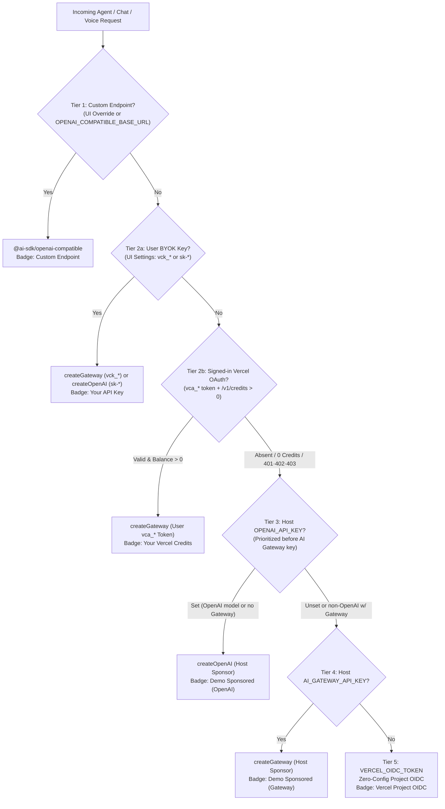

<div align="center">
  
  <h1>Web ADE</h1>
  <p><strong>Open-Source Web Agent Development Environment · <a href="https://web-ade.com">web-ade.com</a></strong></p>
  <p>
    Serene, content-first AI chat paired with an on-demand progressive Workbench — live browser &amp; desktop streaming,
    in-browser WASM &amp; cloud sandbox terminal, code &amp; artifact editor, guardrailed generative UI, trace waterfall,
    multi-harness execution, and a 5-tier provider &amp; billing waterfall.
  </p>

  <p>
    <a href="https://vercel.com/new/clone?repository-url=https%3A%2F%2Fgithub.com%2Fmarkeljan%2Fweb-ade&project-name=web-ade&repository-name=web-ade&stores=%5B%7B%22type%22%3A%22integration%22%2C%22integrationSlug%22%3A%22neon%22%2C%22productSlug%22%3A%22database%22%2C%22protocol%22%3A%22storage%22%7D%2C%7B%22type%22%3A%22blob%22%2C%22access%22%3A%22public%22%7D%5D&env=BETTER_AUTH_SECRET&envDescription=BETTER_AUTH_SECRET%20signs%20Better%20Auth%20sessions%20%E2%80%94%20use%20at%20least%2032%20random%20chars.%20AI%20models%20work%20zero-config%20via%20Vercel%20Project%20OIDC%20AI%20Gateway%20billing%3B%20optionally%20add%20OPENAI_API_KEY%2C%20AI_GATEWAY_API_KEY%2C%20or%20VERCEL_CLIENT_ID%20and%20VERCEL_CLIENT_SECRET%20after%20deploy.&envLink=https%3A%2F%2Fgithub.com%2Fmarkeljan%2Fweb-ade%23environment-variables">
      
    </a>
  </p>

  <p>
    
    
    
    
    
  </p>
</div>

---

## Why `Web ADE`?

Most web AI templates are either minimal text-only chatbots or cluttered browser IDEs. **Web ADE** ([web-ade.com](https://web-ade.com)) starts as a calm, **Astryx-styled** chat canvas and progressively reveals a resizable **Workbench** only when your workflow calls for it:

- **Preview / Live Browser & Desktop**: Instant `<iframe>` preview, 60fps `screen-relay` WebCodecs H.264 desktop streaming with one-click **Take Control / Hand Back**, `agent-browser` live JPEG pair-browsing, and universal SSRF-guarded HTTP snapshot fallback.
- **Instant WASM + Cloud VM Terminal**: `@wterm/react` + `@wterm/just-bash` runs immediately in the browser with zero setup and upgrades seamlessly to persistent `@vercel/sandbox` Ubuntu microVMs.
- **Guardrailed Generative UI + Codegen**: Streams interactive Astryx widgets inline via `@json-render/*`, promotes them to a dedicated Canvas pane, and exports clean React TSX.
- **Self-Operating ADE (`@ui-sdk/react/agent`)**: The agent can inspect and drive the ADE's own interface (`ui_snapshot` / `ui_act`) behind a human-in-the-loop Sentinel approval gate.
- **Multi-Harness Execution**: Hot-swap between **AI SDK 7** (`ai-sdk`), durable **`libfx`** (`fx`), and **Workflow 5 `WorkflowAgent`** (`workflow`).
- **Zero-Friction Deployment & Local Dev**: One-click Vercel deploy auto-provisions **Neon Postgres** + **Vercel Blob** and bills AI Gateway automatically via **Vercel Project OIDC** — while local development (`bun install && bun dev`) runs immediately with zero cloud credentials using an atomic local JSON store and `just-bash`.

---

## One-Click Deploy with Vercel

Click **Deploy with Vercel** above to clone `https://github.com/markeljan/web-ade` with:

1. **Neon Postgres** auto-provisioned via Vercel Marketplace (`neon` / `database` storage integration) → sets `DATABASE_URL`.
2. **Vercel Blob** (`public` store) auto-provisioned → sets `BLOB_READ_WRITE_TOKEN` for multimodal attachments & generated images.
3. **`BETTER_AUTH_SECRET`** prompt for session signing (generate with `openssl rand -base64 32`).
4. **Zero-Config AI Models via Vercel Project OIDC**: Once deployed, `VERCEL_OIDC_TOKEN` automatically authenticates Vercel AI Gateway (Tier 5) so frontier models work out of the box. You can optionally add `OPENAI_API_KEY`, `AI_GATEWAY_API_KEY`, `VERCEL_CLIENT_ID` + `VERCEL_CLIENT_SECRET`, or `VERCEL_SANDBOX_SNAPSHOT_ID` at any time.

After your first deploy, run `bun run db:push` (or connect locally via `vercel env pull .env.local && bun run db:push`) to create the Drizzle tables in Neon Postgres.

---

## Feature Showcase (Vercel & Vercel Labs Stack)

| Capability | Packages (Verified Versions) | What It Powers in Web ADE |
|---|---|---|
| **AI SDK 7 Core & Streaming** | `ai@7.0.177`, `@ai-sdk/react@4.0.181`, `@ai-sdk/gateway@4.0.150`, `@ai-sdk/openai@4.0.121`, `@ai-sdk/openai-compatible@3.0.93`, `resumable-stream@2.2.13` | `streamText`, `createUIMessageStream`, `isStepCount(12)`, Zod v4 `tool({ inputSchema, needsApproval })`, unified `{ type: 'file', data, mediaType }` multimodal parts, Sentinel tool approvals (`addToolApprovalResponse`), inline `ask_user` cards, message branching, and optional Upstash Redis resumable streams. |
| **Headless Chrome & UI Agent Bridge** | `@ui-sdk/react@0.1.0-beta.13`, `@ui-sdk/core@0.1.0-beta.13` | Resizable Chat ↔ Workbench split (`./resizable`), `⌘K` Command Palette (`./command`), workspace File Tree (`./tree`), `/` & `@` composer Trigger Menu (`./trigger-menu`), latency Trace Waterfall (`./waterfall`), zero-flash theme persistence (`./preferences`), and **`createAgent()` Self-Operating UI Bridge** (`./agent`) with human approval & optional WebMCP. |
| **Guardrailed Generative UI + Codegen** | `@json-render/core@0.23.2`, `@json-render/react@0.23.2`, `@json-render/codegen@0.23.2`, `recharts@3.11.0` | Strict Zod v4 catalog of 13 Astryx components (`MetricCard`, `MetricGrid`, `DataTable`, `Chart`, `Callout`, `Tabs`, `Timeline`, `DiffCard`, `CodePreview`, `ActionBar`, `Form`, `ApprovalCard`, `AskUserCard`) + 6 interactive actions streamed via `pipeJsonRender`, promoted to the GenUI Canvas pane, and exported to React TSX. |
| **Astryx Design System + 4 Palettes** | `tailwindcss@4.3.5`, `@base-ui/react@1.9.0`, `lucide-react@1.76.0`, `sonner@2.0.8` | Zero-rerender native CSS `light-dark()` tokens driven by `color-scheme` + `data-astryx-theme` (`neutral`, `stone`, `matcha`, `obsidian`), `Figtree` + `JetBrains Mono`, concentric radii (`8 / 12 / 16 / 28 / 32px`), 3-tier motion bands (`125 / 300 / 700ms`), and `useStreamingText` rAF smoother. |
| **Streaming Markdown** | `streamdown@2.8.0`, `@streamdown/code@2.0.1`, `@streamdown/math@1.0.4`, `@streamdown/mermaid@1.0.4` | Drop-in streaming Markdown with incomplete-syntax recovery (`remend`), Shiki syntax highlighting, KaTeX math, and live Mermaid diagram rendering. |
| **`libfx` / `fx0` Durable Coding Harness** | `libfx@0.0.17`, `@vercel/config@0.15.0` | Selectable `fx` harness mode (`lib/harnesses/fx.ts`) with per-turn 5-tier credential-injecting `FxFetch`, 64-step budget guard, explicit `idempotent` coding tools, and Fluid Compute `queue/v2beta` wake handler at `/api/libfx` (topic `__libfx_wkf_workflow_session` configured in `vercel.ts`). |
| **Workflow 5 `WorkflowAgent` Harness** | `workflow@5.7.0`, `@ai-sdk/workflow@2.0.109`, `@opentelemetry/api@1.10.0` | Selectable `workflow` harness mode (`lib/workflows/agent-workflow.ts`) using `"use workflow"` + `"use step"` directives, `withWorkflow` in `next.config.ts`, and reconnectable streams at `/api/workflow` & `/api/workflow/[runId]`. |
| **Web Terminal & Dual-Tier Sandbox** | `@wterm/react@0.6.0`, `@wterm/just-bash@0.6.0`, `just-bash@3.6.1`, `bash-tool@1.3.19`, `@vercel/sandbox@4.0.0`, `codemirror@6.0.2` | Instant browser WASM shell (`@wterm/just-bash` + `webmcp={{ name: 'shell' }}`) paired with `just-bash` `InMemoryFs` + `bash-tool` — seamlessly upgrading to persistent `@vercel/sandbox` Ubuntu microVMs exposing ports `3000`, `4848`, and `8080`, plus CodeMirror 6 file & versioned artifact editing. |
| **Live Browser & Desktop Streaming** | `screen-relay@0.1.2`, `@agent-browser/sandbox@0.43.0`, `remote-agent-browser@1.3.0` | Unified 4-mode `<BrowserPane />`: **Mode A** `<iframe>` App Preview, **Mode B** 60fps `screen-relay` `NSL1` WebCodecs H.264 stream with server-minted short-lived `/tickets` + `ticket.<TOKEN>` WebSocket handshake (`/api/sandbox/relay-grant`, `/stream` vs `/stream?view=1`) & single-owner **Take Control / Hand Back**, **Mode C** `agent-browser` WS JPEG pair-browsing (`@eN` refs), and **Mode D** universal DNS/SSRF-guarded HTTP snapshot (`agent-desktop` pre-baked in optional Sandbox snapshot). |
| **Voice (STT / TTS / Realtime) & Multimodal** | `ai@7.0.177`, `@ai-sdk/react@4.0.181`, `@vercel/blob@2.9.0` | 3-tier voice stack — STT (`/api/voice/transcribe`), TTS (`/api/voice/speak`), and Live Realtime Voice (`/api/realtime/token` + `experimental_useRealtime` with Web Speech API fallback) — plus OpenAI image generation (`openai/gpt-image-2`) and Vercel Blob uploads (base64 fallback locally). |
| **GitHub Engineering Tools** | `@github-tools/sdk@1.24.0` | Optional GitHub tool pack (`repo-explorer` preset) activated dynamically when a user supplies a personal GitHub token in Settings — explore repositories, inspect issues/PRs, and review diffs directly from chat. |
| **Remote MCP Server (`/api/mcp`)** | `mcp-handler@2.4.0`, `@modelcontextprotocol/server@2.4.0` | Stateless Streamable HTTP MCP server (optionally secured by `ADE_MCP_TOKEN` Bearer auth) exposing `workspace_list_files`, `workspace_read_file`, `workspace_write_file`, `workspace_bash`, and `browser_open_and_snapshot` so external agents (Claude Code, Cursor, `fx`) can drive ADE workspaces. |
| **Database, Auth & Observability** | `drizzle-orm@0.45.4`, `@neondatabase/serverless@1.2.1`, `better-auth@1.7.26`, `@vercel/connect@2.9.5`, `@vercel/functions@3.11.3` | Neon Postgres via Drizzle with automatic local JSON fallback (`.web-ade-data/store.json`), **Sign in with Vercel OAuth + Instant Guest Sessions + BYOK** (with automatic ownership transfer on sign-in), optional Vercel Connect, and low-cardinality `@vercel/functions` metrics. |

---

## 5-Tier Provider & Billing Waterfall

Every chat turn, harness run, voice request, and image generation resolves its model provider strictly through `lib/ai/provider.ts` in the following priority order. The active `BillingSource` is surfaced transparently in the header badge, and raw API keys or OAuth tokens are never logged, stored in chat history, or returned to the browser.



| Tier | Source | Resolution Behavior | UI Billing Badge |
|---|---|---|---|
| **1** | **Custom OpenAI-Compatible Endpoint** | UI Settings override or `OPENAI_COMPATIBLE_BASE_URL` (+ optional `OPENAI_COMPATIBLE_API_KEY` & `OPENAI_COMPATIBLE_MODEL`) via `@ai-sdk/openai-compatible` (Ollama, vLLM, LM Studio, OpenRouter). | `Custom Endpoint` |
| **2a** | **User BYOK Key** | Key entered in **Settings → Providers** (`vck_*` → `createGateway`, `sk-*` → `createOpenAI`). Stored locally in browser preferences and sent only per-request over HTTPS. | `Your API Key` |
| **2b** | **Sign in with Vercel OAuth (`vca_*`)** | Signed-in user's Vercel OAuth access token (1h TTL, auto-refreshed via 30d `refresh_token`). Verified via `GET https://ai-gateway.vercel.sh/v1/credits` (60s SHA-256-hashed cache). Automatically falls back to Tier 3+ if credits are `0` or on HTTP `401`/`402`/`403`. | `Your Vercel Credits` |
| **3** | **Host Sponsor `OPENAI_API_KEY` (First)** | Prioritized ahead of `AI_GATEWAY_API_KEY`. Sponsored mode is limited to **`openai/gpt-6-luna`** (default) and **`anthropic/claude-haiku-5.5`** until a user supplies their own key. | `Demo Sponsored (OpenAI)` |
| **4** | **Host Sponsor `AI_GATEWAY_API_KEY`** | Sponsored Vercel AI Gateway access limited to **`openai/gpt-6-luna`** (default) and **`anthropic/claude-haiku-5.5`**. Adding your own BYOK key unlocks all curated OpenAI & Anthropic models (GPT-6.2 Sol/Astra, GPT-5.3 Codex, Claude Sonnet/Opus 5.5). | `Demo Sponsored (Gateway)` |
| **5** | **Vercel Project OIDC (`VERCEL_OIDC_TOKEN`)** | Automatic zero-config default on Vercel deployments — bills the deployer's own Vercel AI Gateway credits (sponsored models: **`openai/gpt-6-luna`** default & **`anthropic/claude-haiku-5.5`**). | `Vercel Project OIDC` |

---

## Sign in with Vercel & Vercel Connect Setup Guide

Web ADE authenticates users via **Sign in with Vercel OAuth + Instant Guest Sessions + BYOK** (zero friction on first visit via HMAC-signed anonymous guest sessions, with optional BYOK keys in Settings). Follow these steps to enable **Sign in with Vercel** so signed-in users can automatically bill usage to their own Vercel AI Gateway credits (Tier 2b):

### 1. Create a Vercel OAuth App
1. Open your Vercel Team Dashboard:
   `https://vercel.com/<team>/~/settings/apps` → **Create**
2. Configure **Callback URLs** (Better Auth native `socialProviders.vercel`):
   - Local development: `http://localhost:3000/api/auth/callback/vercel`
   - Production: `https://<your-domain>/api/auth/callback/vercel`
3. Select **OAuth Scopes**:
   - `openid`
   - `profile`
   - `email`
   - `offline_access` *(required for 30-day refresh tokens that renew 1-hour `vca_*` access tokens automatically)*
4. Configure **Team Permissions** *(currently Private Beta on Vercel Apps)*:
   - **`AI Gateway: Use`** *(required to bill AI Gateway calls to the user's token)*
   - **`Team: Read Only`** *(optional — enables team-scoped credit checks)*
5. Copy the generated credentials into `.env.local` and your Vercel Project Environment Variables:
   ```bash
   VERCEL_CLIENT_ID="cl_..."
   VERCEL_CLIENT_SECRET="..."
   ```

### 2. Automatic Sponsor Fallback
If a user signs in without `AI Gateway: Use` enabled on your Vercel App, has `$0` remaining credits, or encounters an upstream `401`/`402`/`403` billing response from AI Gateway, Web ADE automatically invalidates the cached credit result and transparently retries on **Tier 3–5** (host sponsor / project OIDC) without failing the conversation. When an anonymous guest signs in, their existing chats, artifacts, and workspace files are automatically transferred to their authenticated account.

### 3. Optional: Vercel Connect (`@vercel/connect/betterauth`)
If you prefer OIDC-backed connector token exchange without static client secrets:
1. Add `https://connect.vercel.com/callback` to your Vercel App's callback URLs.
2. Create and attach the connector via the Vercel CLI:
   ```bash
   vercel connect create vercel --connection-method oauth
   vercel connect attach <connector-uid>
   ```
3. Set `VERCEL_CONNECT_VERCEL_UID=<connector-uid>` in your environment. Better Auth automatically registers the `@vercel/connect/betterauth` `genericOAuth` provider (callback path `/api/auth/oauth2/callback/<providerId>`).

---

## Local Quickstart (Zero Cloud Credentials Required)

**Requirements**: [Bun](https://bun.sh) `1.4+` and Node.js `>=22.12.0`.

```bash
git clone https://github.com/markeljan/web-ade.git
cd web-ade
bun install
cp .env.example .env.local
bun dev
```

Open [http://localhost:3000](http://localhost:3000).

- **Works immediately without Postgres, Blob, Redis, or Vercel Sandbox**:
  - Persistence automatically falls back to an atomic local JSON store (`.web-ade-data/store.json`).
  - Uploads fall back to inline base64 data URLs.
  - The workspace shell & `@wterm/react` terminal run immediately via in-browser `just-bash` WASM (`InMemoryFs`).
- **Configure a model provider** via either:
  - Setting `OPENAI_API_KEY`, `AI_GATEWAY_API_KEY`, or `OPENAI_COMPATIBLE_BASE_URL` (e.g. `http://localhost:11434/v1` for Ollama) in `.env.local`, **or**
  - Clicking **Settings → Providers** in the app UI to enter a BYOK key or custom endpoint live with zero restart, **or**
  - Linking your Vercel project to pull OIDC & provisioned store variables:
    ```bash
    vercel link
    vercel env pull .env.local
    ```

---

## Database & Sandbox Snapshot Guide

### Neon Postgres Schema Push (Drizzle ORM)

Once `DATABASE_URL` is configured in `.env.local` (via `vercel env pull .env.local` or manually):

```bash
# Push schema directly to Neon Postgres
bun run db:push

# Optional: generate SQL migration files
bun run db:generate
```

This creates the 9 tables defined in `lib/db/schema.ts`: Better Auth tables (`user`, `session`, `account`, `verification`) plus ADE tables (`chat`, `message`, `vote`, composite-PK versioned `artifact`, and composite-PK `workspace_file`).

### Pre-Baking a `@vercel/sandbox` Snapshot (`<1s` Boot)

Tier 1 (`just-bash`) runs instantly everywhere. When `VERCEL_OIDC_TOKEN` (or `VERCEL_TOKEN`) is present, Web ADE can upgrade any workspace to a real Tier 2 Ubuntu `@vercel/sandbox` microVM exposing ports `3000` (app preview), `4848` (`agent-browser` dashboard), and `8080` (`screen-relay`).

Pre-bake a reusable snapshot so browser and full-desktop sandboxes boot in `<1s` instead of installing packages at runtime:

```bash
# Validate credentials & preview build steps without billing
bun run sandbox:snapshot -- --dry-run

# Fast browser-only snapshot (agent-browser + Chromium + fx CLI)
bun run sandbox:snapshot -- --skip-desktop

# Full desktop + browser snapshot (agent-browser + Chromium + screen-relay XFCE/X11 + agent-desktop + fx CLI)
bun run sandbox:snapshot
```

Copy the emitted `VERCEL_SANDBOX_SNAPSHOT_ID=snap_...` into `.env.local` and your Vercel Project Environment Variables.

---

## Environment Variables

See [`.env.example`](./.env.example) for the complete annotated template.

| Variable | Required? | Purpose |
|---|---|---|
| `BETTER_AUTH_SECRET` | **Production** | Min 32-char secret for Better Auth session & guest cookie signing (`openssl rand -base64 32`). |
| `DATABASE_URL` | Optional *(Neon)* | Neon Postgres connection string. Falls back to `.web-ade-data/store.json` locally when unset. |
| `BLOB_READ_WRITE_TOKEN` | Optional *(Blob)* | Vercel Blob token for file/image uploads. Falls back to base64 data URLs locally. |
| `BETTER_AUTH_URL` / `NEXT_PUBLIC_APP_URL` | Optional | Public origin URL for OAuth callbacks & WS origin checks (auto-detected on Vercel; defaults to `http://localhost:3000`). |
| `OPENAI_API_KEY` | Optional *(Tier 3)* | Host sponsor direct OpenAI key — prioritized ahead of `AI_GATEWAY_API_KEY`. |
| `AI_GATEWAY_API_KEY` | Optional *(Tier 4)* | Host sponsor Vercel AI Gateway key (`vck_...`) for 500+ models. |
| `OPENAI_COMPATIBLE_BASE_URL` | Optional *(Tier 1)* | Custom OpenAI-compatible base URL (Ollama, vLLM, LM Studio, OpenRouter). Pairs with optional `OPENAI_COMPATIBLE_API_KEY` and `OPENAI_COMPATIBLE_MODEL`. |
| `VERCEL_OIDC_TOKEN` | Auto on Vercel *(Tier 5)* | Auto-injected on Vercel deployments (or pulled via `vercel env pull .env.local`); powers zero-config AI Gateway & `@vercel/sandbox`. |
| `VERCEL_CLIENT_ID` / `VERCEL_CLIENT_SECRET` | Optional *(Tier 2b)* | Sign in with Vercel OAuth credentials for user-billed AI Gateway credits. |
| `VERCEL_CONNECT_VERCEL_UID` | Optional | Vercel Connect OAuth connector UID for `@vercel/connect/betterauth`. |
| `VERCEL_SANDBOX_SNAPSHOT_ID` | Optional | Pre-baked `@vercel/sandbox` snapshot ID from `bun run sandbox:snapshot`. |
| `UPSTASH_REDIS_REST_URL` / `UPSTASH_REDIS_REST_TOKEN` | Optional | Enables `resumable-stream` across reconnects (`/api/chat/[id]/stream` returns `204` cleanly when unset). |
| `ADE_MCP_TOKEN` | Optional | Bearer token securing `/api/mcp` (`Authorization: Bearer <token>`) for remote MCP clients and private workspace access. |

---

## Architecture & Remote MCP

```text
web-ade/
├── app/
│   ├── api/
│   │   ├── chat/                 # AI SDK 7 streaming (/api/chat), resumable stream, fx harness (/api/chat/fx)
│   │   ├── libfx/                # Private Fluid Compute queue/v2beta wakeHandler (__libfx_wkf_workflow_session)
│   │   ├── workflow/             # Workflow 5 WorkflowAgent start & run reconnection (/api/workflow/[runId])
│   │   ├── sandbox/              # Dual-tier sandbox status, exec, files CRUD, /tickets relay-grant, browser actions
│   │   ├── voice/ & realtime/    # STT (/api/voice/transcribe), TTS (/api/voice/speak), Realtime token minting
│   │   ├── mcp/                  # Stateless Streamable HTTP Remote MCP Server
│   │   ├── provider/status/      # Safe zero-secret 5-tier provider diagnostics & credit status
│   │   ├── chats/, artifacts/, upload/, auth/
│   ├── globals.css               # Astryx light-dark() tokens, 4 palettes, @theme inline, Streamdown @source globs
│   ├── layout.tsx                # Figtree + JetBrains Mono, zero-flash preferences bootstrap, UiAgentProvider
│   └── page.tsx & chat/[id]/     # Server-rendered entry routes
├── components/
│   ├── ade/                      # AdeShell, ChatPane, Composer, CommandPalette, SettingsDialog, Sidebar, VoiceModal
│   ├── ai-elements/              # Streamdown renderer, Reasoning, TracePill, ConfirmationCard, AskUserCard, ContextMeter
│   ├── genui/                    # Astryx json-render registry (13 components / 6 actions) + TSX codegen
│   ├── ui/                       # Base UI (@base-ui/react) React 19 primitives
│   └── workbench/                # Resizable Workbench: BrowserPane (4 modes), TerminalPane (@wterm), Files, GenUI, Trace
├── lib/
│   ├── ai/                       # 5-tier provider waterfall, OpenAI + Anthropic catalog, credits checker, GenUI catalog, 19 ADE tools
│   ├── auth/ & db/               # Better Auth + Sign in with Vercel, Drizzle Neon schema + local JSON fallback
│   ├── harnesses/ & workflows/   # libfx durable harness & Workflow 5 WorkflowAgent
│   ├── sandbox/                  # just-bash ↔ @vercel/sandbox manager & 4-mode browser/screen-relay service
│   └── theme/ & ui-agent/        # Astryx token helpers, useStreamingText, @ui-sdk/react/agent bridge
├── scripts/create-sandbox-snapshot.ts
├── vercel.ts                     # @vercel/config/v1 Fluid Compute + libfx queue trigger
└── proxy.ts                      # Next.js 16 proxy hydrating HMAC-signed guest cookie (excludes /.well-known/workflow)
```

### Connecting External Agents to `/api/mcp`

Any MCP-compatible client (Claude Code, Cursor, `fx`, etc.) can connect to your running Web ADE workspace over Streamable HTTP:

```json
{
  "mcpServers": {
    "web-ade": {
      "url": "http://localhost:3000/api/mcp",
      "headers": {
        "Authorization": "Bearer <ADE_MCP_TOKEN>"
      }
    }
  }
}
```

> Set `ADE_MCP_TOKEN` in `.env.local` (or Vercel Project Env Vars) to require Bearer authentication for remote MCP clients and private chat workspaces; omit `headers` during unauthenticated local testing against the `"default"` workspace.

Exposed tools: `workspace_list_files`, `workspace_read_file`, `workspace_write_file`, `workspace_bash` (Sentinel-guarded), and `browser_open_and_snapshot`.

---

## Scripts & Keyboard Shortcuts

| Command | Description |
|---|---|
| `bun dev` | Start Next.js 16 development server |
| `bun run build` | Production Next.js 16 + Workflow 5 + Tailwind v4 build |
| `bun run start` | Start production server |
| `bun run typecheck` | Strict TypeScript 7 check (`tsc --noEmit`) |
| `bun run lint` / `bun run lint:fix` | Biome v2 lint & format check / auto-fix |
| `bun run db:push` / `bun run db:generate` | Push Drizzle schema to Neon / generate migrations |
| `bun run test` | Run Bun unit & API integration tests (`bun test`) |
| `bun run test:e2e` | Run Playwright end-to-end suite (`playwright test`) |
| `bun run sandbox:snapshot` | Pre-bake a `@vercel/sandbox` snapshot for `<1s` boot |

**Keyboard Shortcuts**: `⌘K` Command Palette · `⌘.` Toggle Workbench · `⌘J` Toggle Terminal · `⌘⇧O` New Chat · `/` Slash Commands · `@` Mentions & Tools.

---

## Antigravity Customizations

This repository ships first-class agent instructions, workspace rules, and architectural skills so AI coding agents stay 100% aligned with AI SDK 7, the 5-tier billing waterfall, Astryx tokens, and security invariants:

- **[`AGENTS.md`](./AGENTS.md)** — Engineering handbook, non-negotiable SDK rules, billing waterfall order, security invariants, and verification commands.
- **[`.agents/rules/web-ade.md`](./.agents/rules/web-ade.md)** — Always-on workspace rules enforced on every edit.
- **[`.agents/skills/ade-architecture/SKILL.md`](./.agents/skills/ade-architecture/SKILL.md)** — Deep architectural reference and implementation runbook covering every subsystem.

---

## License & Credits

Released under the **[MIT License](./LICENSE)**.

Built with open-source craftsmanship from the **[Vercel](https://vercel.com)**, **[Vercel Labs](https://github.com/vercel-labs)**, and open-web ecosystems:

- **[Next.js 16](https://nextjs.org)**, **[React 19](https://react.dev)**, **[AI SDK 7](https://ai-sdk.dev)**, **[Workflow 5](https://useworkflow.dev)**, and **[Vercel Sandbox](https://vercel.com/docs/vercel-sandbox)**
- **Vercel Labs**: [`@ui-sdk/react`](https://ui-sdk.dev), [`@json-render/*`](https://json-render.dev), [`streamdown`](https://github.com/vercel/streamdown), [`wterm`](https://github.com/vercel-labs/wterm), [`just-bash`](https://github.com/vercel-labs/just-bash), [`bash-tool`](https://github.com/vercel-labs/bash-tool), [`libfx`](https://github.com/vercel-labs/fx), [`screen-relay`](https://github.com/vercel-labs/screen-relay), [`agent-browser`](https://github.com/vercel-labs/agent-browser), [`mcp-handler`](https://github.com/vercel/mcp-handler), and [`@github-tools/sdk`](https://github.com/vercel-labs/github-tools)
- **[Astryx Design System](https://astryx.atmeta.com)** aesthetic inspiration, **[Base UI](https://base-ui.com)**, **[Tailwind CSS v4](https://tailwindcss.com)**, **[CodeMirror 6](https://codemirror.net)**, **[Drizzle ORM](https://orm.drizzle.team)**, **[Neon](https://neon.tech)**, and **[Better Auth](https://better-auth.com)**
